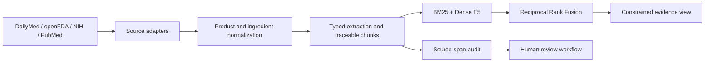

# MedGuide

MedGuide is an evidence-grounded AI engineering project for exploring medication, supplement,
food, and drink interactions and for inspecting scientific studies about a selected ingredient.
It is a research prototype, not a prescribing tool or a substitute for a clinician.

## Project links

- **Live demo:** https://medguidenxt.com/interactions
- **Devpost hackathon project:** https://devpost.com/software/medguide-ai-medication-supplement-intelligence
- **Demo video:** https://youtu.be/zyctKYUrL9U?si=583ddMtDRrbLeXQB
- **GitHub repository:** https://github.com/enterlina/medguide

## Nebius x NVIDIA Global AI Hackathon

MedGuide is submitted to the **Best Apps and Agents** track. Its evidence-synthesis path makes a
runtime inference request to **NVIDIA Nemotron 3 Nano (`nvidia/NVIDIA-Nemotron-3-Nano-30B-A3B`)**
through the **Nebius Token Factory API**. The provider adapter fails closed when Nebius credentials
are absent and never labels another provider as Nebius. A sanitized runtime trace and provider
documentation are included in
[`artifacts/nebius-hackathon`](medguide-evidence-engine/artifacts/nebius-hackathon) and
[`docs/model_card.md`](medguide-evidence-engine/docs/model_card.md).

The project existed as an early medication-management prototype before the submission period. It
was substantially expanded during the hackathon with source adapters, interaction extraction,
hybrid retrieval, citation and source-span validation, human-review states, the Taking & Combining
experience, the What Studies Say evidence catalog, a Nebius/Nemotron synthesis adapter, safety
evaluation, and a deployed public demo. See the
[`hackathon change log`](medguide-evidence-engine/docs/hackathon_changes.md) for the dated scope.

The product has two focused journeys:

- **Taking & Combining** presents practical guidance derived from FDA, DailyMed, and NIH sources.
- **What Studies Say** presents structured PubMed evidence with study design, participants,
  results, relevance, and source links.

## Why this project is different

MedGuide treats provenance and clinical interpretation as different checks. A rule can have an
exact source passage without being clinically approved. Missing evidence is kept unknown, trial
registrations are not treated as positive results, and AI-screened studies remain separate from
human-reviewed evidence.



## Measured status — 2026-10-30

### Safety and provenance

| Measure | Current result | Interpretation |
| --- | ---: | --- |
| Stored interaction rules | 7,865 | Extracted candidates, not clinical approvals |
| Exact passages found in stored source sections | 7,864 / 7,865 (99.99%) | Automated provenance check only |
| Deduplicated rule signatures | 6,912 | 813 duplicate groups remain in stored history |
| Human-reviewed rules | 0 | Clinical validation is still pending |
| Curated safety cases resolved by the current resolver | 31 / 56 (55.4%) | Coverage measure |
| Findings returned for resolved must-detect cases | 8 / 30 (26.7%) | Current safety-recall proxy |
| False-reassurance proxy | 22 / 30 (73.3%) | Release blocker, not a population estimate |
| Returned findings with a source URL | 24 / 24 | URL coverage, not citation precision |

These numbers are intentionally reported even when they are unfavorable. The current engineering
priority is safety coverage and citation validation, not another UI feature or model swap.

### Retrieval

On the 323-query NFCorpus test set, RRF reached nDCG@10 **0.3461** (95% bootstrap CI
**0.3113–0.3813**). RRF outperformed BM25 by **+0.0373**, while its **+0.0106** difference over
Dense E5 was not statistically distinguishable from zero (`p ≈ 0.13`).

The BioASQ experiment is a **200-question restricted-corpus pilot**, not the official full-PubMed
leaderboard benchmark. RRF reached nDCG@10 **0.7797** and Recall@20 **0.8280** in that setup.

The MedGuide-specific retrieval set currently has no fully reviewed pools, so no internal ranking
metric is claimed yet. Unreviewed results are never counted as irrelevant.

## Technology

- Next.js 16, React 19, TypeScript, Tailwind CSS
- FastAPI, Pydantic, SQLite repository layer
- BM25, `intfloat/multilingual-e5-base`, Reciprocal Rank Fusion
- DailyMed SPL, openFDA labels, NIH ODS, RxNorm, PubMed/PMC, ClinicalTrials.gov
- Deterministic audit artifacts and a role-aware human-review workflow

## Local development

Frontend:

```bash
npm install
npm run dev
```

Backend:

```bash
cd medguide-evidence-engine
python -m pip install -e '.[dev,data,ai]'
uvicorn app.main:app --reload
```

Run all local checks:

```bash
make check
```

Environment variables belong in local `.env` files. Use `.env.example` as the template and never
commit provider keys.

## Documentation

- [AI engineering portfolio case](medguide-evidence-engine/docs/portfolio_ai_engineering_case.md)
- [Evaluation improvement report](medguide-evidence-engine/docs/evaluation_improvement_report.md)
- [Retrieval evaluation policy](medguide-evidence-engine/docs/retrieval_evaluation_policy.md)
- [Hackathon MVP plan](medguide-evidence-engine/docs/hackathon_mvp_plan.md)

## Known limitations

- The interaction corpus is not clinically validated and currently has zero human-reviewed rules.
- Exact source matching proves provenance, not correct medical interpretation.
- The current curated safety benchmark reveals substantial missed-interaction risk.
- Automated product-to-ingredient mappings and AI study screening still need sampled human audits.
- PubMed candidates may be indirect evidence and are not automatically conclusions about a product.

## AI assistance disclosure

AI coding tools assisted with implementation, refactoring, test generation, and documentation.
Design decisions, source selection, evaluation boundaries, and acceptance of changes remain part of
the project author's engineering work. Machine-generated medical interpretations are not labeled
as human-reviewed.

## License

Code is provided under the repository [LICENSE](LICENSE). External datasets and source documents
retain their original terms; public releases should use download scripts and small evaluation
fixtures rather than redistributing bulk source corpora.
